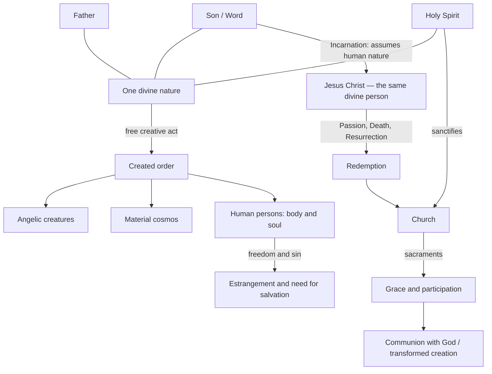

# Catholic World Model v0.1 — God, Creation, and Salvation

**Research artifact, not a finished film or a formalization of every Catholic doctrine.** This is an editorially structured, source-grounded model of a coherent Catholic theological account. Its source backbone is the Nicene Creed and the *Catechism of the Catholic Church* (CCC). The machine-readable graph is [v0.1.json](v0.1.json).

## Purpose and scope

The earlier botanical film explored **one** doctrine—creation and ongoing sustenance—but failed to introduce who God is, who Christ is, what humanity is, why sin and redemption matter, or what Catholic salvation entails. It should remain labeled a narrow experiment, not a representative map of Catholic lore.

This model reverses our workflow:

**Authoritative Catholic claims → world model → identified agents and relations → scene casting → visual composition and art direction.**

It is not a metaphysically neutral proof that Catholic teachings are true. It is a representation of what this tradition claims. The conceptual interlingua remains outside and downstream from the tradition-specific source statements: we do not let generic node categories dictate theology.

## 1. Three interwoven structures

### A. Uncreated divine identity (not a historical timeline)

- **One God:** unique, uncreated, eternal, infinite, unchanging, almighty, truth and love (CCC §§199–221).
- **Trinity:** Father, Son and Holy Spirit are distinct divine persons and share **one undivided divine nature**. Not three gods, three created beings, or three roles played by one person (CCC §§232–267).
- **Eternal relations:** the Son is eternally begotten of the Father; Catholic teaching says the Holy Spirit proceeds eternally from the Father and the Son as one principle. These are **not events unfolding before creation**.
- **One action outward:** creation is the work of the undivided Trinity, even when certain actions are attributed particularly to one person (CCC §§290–292).

The first visual distinction to master is **person versus nature**. A film must avoid presenting God as a fourth person above three subordinate persons.

### B. Created order (ontological relations)

- **Free creation ex nihilo:** God creates without needing pre-existing matter; the universe is not a necessary emission of divine substance (CCC §§295–296).
- **Visible and invisible:** there are corporeal creatures, spiritual creatures (angels), and human persons uniting spiritual soul with material body (CCC §§325–354, 362–365).
- **Created agency:** angels and humans are capable of intellect and will, and creatures have real causal capacities (CCC §§330, 306–308).
- **Continuing dependence:** all created existence is sustained by God, rather than simply assembled at an initial moment and abandoned (CCC §301).
- **Original goodness:** creation is ordered and good, though unfinished and capable of suffering, loss and moral failure (CCC §§299, 310–311, 337–349).

A creature is **not** a fraction or detachable particle of God. A human is not an angel wearing a body. Material existence is not intrinsically evil.

### C. The drama of salvation (historical, liturgical, and eschatological relations)

1. **Fall and sin:** created freedom can reject God. Satan and other demons are originally good *created angels* who rejected God, not coeternal darkness deities. Catholic interpretation describes the Genesis Fall in figurative language while affirming a primeval human disobedience (CCC §§390–392).
2. **Covenant and revelation:** God reveals himself within human history, including through Israel; this is part of the unfolding divine–human relationship (CCC §§203–211, 287–288).
3. **Incarnation:** the **eternal Son** assumes full human nature as Jesus Christ. The one divine person is true God and true man, with two natures; this is not a new divine person or a change of God's nature into matter (CCC §§456–483).
4. **Mary:** a created human who freely consents to the Annunciation and is called *Mother of God* because her son Jesus is the incarnate eternal Son—not because she originated his eternal divinity (CCC §§484–511).
5. **Paschal mystery:** Jesus' Passion, death, and Resurrection constitute the central saving event, transforming humanity's relation to sin and death (Creed; CCC §§595–623).
6. **Spirit and Church:** the Holy Spirit sanctifies and animates the Church, which is described as People of God, Body of Christ and Temple of the Spirit; these are complementary metaphors with distinct implications, not three separate organizations (CCC §§742–747, 781–810).
7. **Sacraments and grace:** Christ's saving action is communicated through sacramental life, notably Baptism and Eucharist. Grace is God's gift, not a material liquid or blue/gold particle effect (CCC §§1113–1134, 1406–1419).
8. **Death and final destiny:** Catholic teaching distinguishes judgment, heaven (communion with God), purgatory (purification of some who are saved), and hell (definitive separation from God); bodily resurrection and transformed creation are part of the final fulfillment (CCC §§1020–1050). Do not treat these as ordinary astronomical territories.

## 2. Relational map (not a single spatial hierarchy)

**Diagram limits:** The lines linking the divine persons to the one divine nature express shared divine identity, not three physical conduits. The arrows are differently typed: creation, assumption of humanity, moral change, redemption, and sacramental participation are not one universal transfer mechanism. Source texts, not the diagram layout, govern meaning.

## 3. Category errors the visual system must avoid

| Category error | Why it matters |
|---|---|
| Three divine persons depicted as three created or separate gods | Denies Catholic Trinitarian identity |
| God pictured as one material actor competing with other actors | Confuses creator–creature distinction and the claim of transcendence |
| Son visibly *comes into divine existence* in a temporal sequence | Confuses eternal generation with Incarnation |
| Jesus represented as two different persons (one divine, one human) | Misstates one person in two natures |
| Mary treated as divine or as originating the Son's divine nature | Confuses human motherhood with eternal divine relation |
| Angels represented as inherently demonic | Confuses created angels with fallen angels |
| Body treated as a prison and salvation as shedding materiality | Misstates embodied humanity and bodily resurrection |
| Evil shown as a coeternal self-existing darkness-god | Introduces a dualism rejected by Catholic doctrine |
| Grace represented as a finite physical resource | Implies a mechanism foreign to the doctrine |
| Purgatory shown as a third eternal final outcome alongside heaven/hell | Confuses purification of the saved with a final destination |
| A gold contour simultaneously signifies God, sunlight, moral goodness, and grace | Makes central referents indistinguishable |

## 4. Positive theological claims before artistic metaphors

Before an image is selected, answer: **What entity or event are we depicting? Which qualities and relations does Catholic teaching assign it? Which other interpretations would the image invite?** Artistic choices are unconstrained by exact diagram syntax but must not silently substitute an unrelated metaphysics.

The [casting document](casting-and-film-options.md) proposes a visual role sheet and a possible first film. **No artwork or video is approved or produced by this research PR.**

## 5. What the model does *not* settle

- It does not derive the Trinity from axioms or reduce the doctrine to a solved mathematical structure.
- It does not settle every Latin/Greek theological nuance or denominational dispute; it takes the official Catholic Creed/Catechism as its positive source.
- It does not assign one icon to each entity or pretend that all theological notions admit a unique animation.
- It does not assert that contested claims are empirically established.
- It does not require a film to teach every item listed here.
- It does not guarantee that the first film will be comprehensible in one viewing.

## Source backbone

- [Apostles' and Nicene Creeds](https://www.vatican.va/content/catechism/en/part_one/section_one/chapter_three/article_2/the_credo.html).
- [God: divine existence and attributes, §§199–231](https://www.vatican.va/content/catechism/en/part_one/section_two/chapter_one/article_1.index.html).
- [Trinity, §§232–267](https://www.vatican.va/content/catechism/en/part_one/section_two/chapter_one/article_1/paragraph_2_the_father.index.html).
- [Creator, sustaining providence, §§279–324](https://www.vatican.va/content/catechism/en/part_one/section_two/chapter_one/article_1/paragraph_4_the_creator.index.html).
- [Angels and creation, §§325–354](https://www.vatican.va/content/catechism/en/part_one/section_two/chapter_one/article_1/paragraph_5_heaven_and_earth.html).
- [Humanity, §§355–384](https://www.vatican.va/content/catechism/en/part_one/section_two/chapter_one/article_1/paragraph_6_man.index.html); [Fall, §§385–421](https://www.vatican.va/content/catechism/en/part_one/section_two/chapter_one/article_1/paragraph_7_the_fall.index.html).
- [Incarnation, §§456–483](https://www.vatican.va/content/catechism/en/part_one/section_two/chapter_two/artcile_3.index.html); [Mary, §§484–511](https://www.vatican.va/content/catechism/en/part_one/section_two/chapter_two/artcile_3/paragraph_2_conceived_by_the_power_of_the_holy_spirit_and_born_of_the_virgin_mary.html).
- [Church, §§781–810](https://www.vatican.va/content/catechism/en/part_one/section_two/chapter_three/article_9/paragraph_2_the_church_-_people_of_god%2C_body_of_christ%2C_temple_of_the_holy_spirit.html); [Sacraments, §§1113–1134](https://www.vatican.va/content/catechism/en/part_two/section_one/chapter_one/article_2/in_brief.html).
- [Eucharist, §§1406–1419](https://www.vatican.va/content/catechism/en/part_two/section_two/chapter_one/article_3/in_brief.html); [Final fulfillment, §§1042–1050](https://www.vatican.va/content/catechism/en/part_one/section_two/chapter_three/article_12/vi_hope_of_the_new_heaven_and_the_new_earth.index.html).

**Editorial checkpoint:** primary-source citations are associated with every typed claim in the JSON graph. Classification, visual casting and camera choices remain our own interpretive choices.
